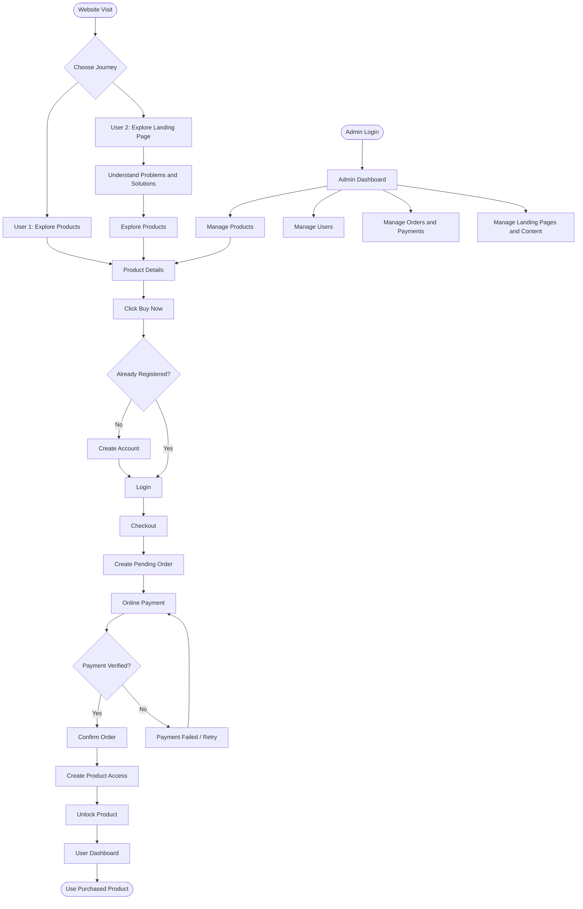
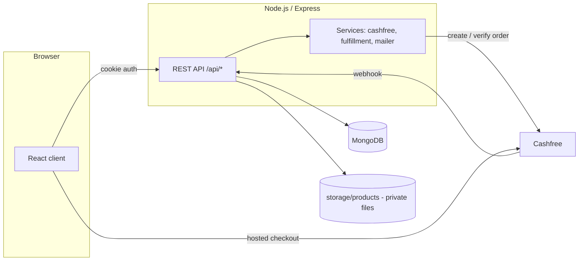

# Architecture

## 1. User and admin journey (from your flowchart - `user-flowchart.png`)

## 2. System components

## 3. Data model

| Collection | Key fields | Purpose |
|---|---|---|
| `User` | name, email, phone, password(hash), role `user|admin`, isActive | accounts |
| `Product` | title, slug, category, price (INR, 0 = free), thumbnail, deliveryType `file|link`, filePath/externalUrl (hidden), isPublished, isFeatured | catalogue |
| `Order` | orderId (Cashfree `order_id`), user, product, amount, status `PENDING|PAID|FAILED|CANCELLED`, gateway, cfPaymentId, paidAt | "Create Pending Order" -> "Confirm Order" |
| `Access` | user, product, order (unique user+product) | "Create Product Access" / "Unlock Product" |
| `Content` | key (`home`), data | editable landing page |

## 4. Order state machine

`PENDING` --(Cashfree reports PAID, amount matches)--> `PAID` -> access created
`PENDING` --(failed / dropped / expired)--> `FAILED` --(user retries)--> new `PENDING` order, old one `CANCELLED`
