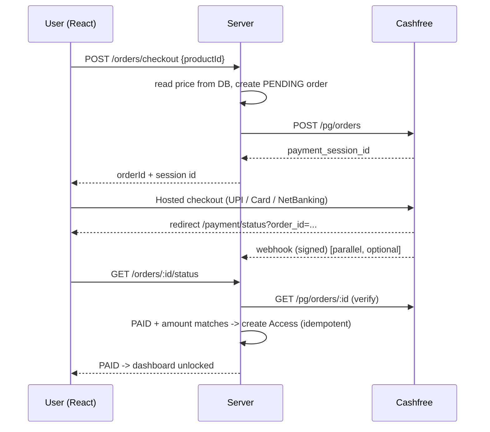

# Payment flow (Cashfree) - from `payment-flow-cashfree.jpeg`

The diagram's "Course / ₹199" example is implemented generically for **any product and price** (the price comes from the database).

| Step in diagram | Implementation |
|---|---|
| **React Frontend** - user clicks *Buy Now* | `ProductDetail.jsx` -> `Checkout.jsx` calls `POST /api/orders/checkout {productId}` |
| **Node.js Backend** - checks product price and user | `orderController.checkout`: loads product from DB, rejects if already owned, uses the logged-in user |
| **Cashfree API** - creates the order | `services/cashfree.js -> createOrder` (`POST /pg/orders`), stores `payment_session_id` on the pending `Order` |
| **Cashfree Checkout** - UPI / Card / Net Banking | `client/src/services/cashfree.js` opens hosted checkout with the session id |
| **Backend Verification** - payment status from Cashfree | `GET /api/orders/:orderId/status` -> `fulfillment.syncOrderStatus` calls `GET /pg/orders/{id}` + payments; **and** `POST /api/payments/webhook` (HMAC-verified) |
| **Payment Success -> Unlock** | `fulfillment.fulfillOrder` marks `PAID`, creates `Access`, sends confirmation email |

**Retry:** a failed/expired order shows *Retry payment*, which creates a fresh order for the same product.
**Free products** skip the gateway and are unlocked immediately.
**Mock mode** (`PAYMENT_MODE=mock`) replaces only the Cashfree hop with `/payment/mock`; everything else is identical.
